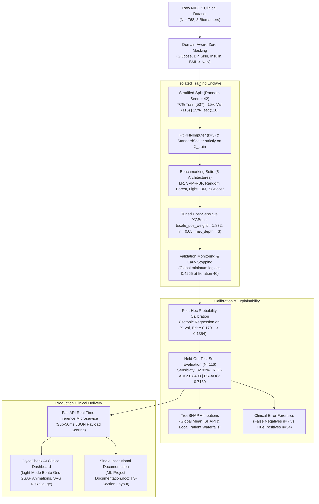

# GlycoRisk AI: Explainable, Risk-Calibrated Diabetes Prediction & Clinical Intelligence Platform

[](https://www.python.org/)
[](https://xgboost.readthedocs.io/)
[](https://scikit-learn.org/)
[](https://shap.readthedocs.io/)
[](https://fastapi.tiangolo.com/)
[](https://creativecommons.org/publicdomain/zero/1.0/)
[](#institutional-metadata--academic-governance)

> **Autonomous Clinical Decision Support System (CDSS) for Early-Onset Type-2 Diabetes Mellitus Risk Triaging, Post-Hoc Probability Calibration, Game-Theoretic Interpretability, and Clinical Error Forensics.**

---

## Executive Summary & Clinical Rationale

Type-2 Diabetes Mellitus (T2D) is a chronic metabolic disease characterized by progressive peripheral insulin resistance, impaired pancreatic $\beta$-cell secretion, and chronic hyperglycemia. Delayed diagnosis exponentially increases the incidence of irreversible microvascular pathologies (diabetic nephropathy, retinopathy, and peripheral neuropathy) and macrovascular complications (accelerated atherosclerosis, acute myocardial infarction, and cerebrovascular stroke).

While machine learning algorithms hold transformative potential for population-scale diabetes screening, historical benchmarks on tabular clinical cohorts (such as the canonical NIDDK Pima Indians Diabetes Dataset) suffer from **three critical methodological flaws**:

```
                                LEGACY ML FLAWS IN CLINICAL LITERATURE
                                
  [1. Biological Zero Fallacy]            [2. Pervasive Data Leakage]            [3. Probability Distortion]
   treating unrecorded measurements         fitting imputers & scalers on          raw tree outputs yield deceptive
  (0 insulin / 0 skinfold) as genuine      the full cohort before splitting;      confidence scores unaligned with
  zero physiological readings              producing overly optimistic scores     empirical clinical frequencies
```

**GlycoRisk AI** resolves these limitations through an end-to-end, clinically defensible engineering architecture:
1. **Domain-Aware Zero Semantics**: Masks biologically impossible zero readings in Glucose, Blood Pressure, Skinfold Thickness, Insulin, and BMI as `NaN`, preserving authentic gestational zeros in Pregnancies, followed by leak-free $k$-Nearest Neighbors ($k=5$) multivariate imputation.
2. **Strict Leak-Free Isolation**: Partitions the cohort into an isolated 70% Train ($N=537$), 15% Validation ($N=115$), and 15% Test ($N=116$) stratified split *before* fitting any imputer or standard scaler.
3. **Cost-Sensitive GBDT Optimization**: Employs Extreme Gradient Boosting (XGBoost) with minority class weighting ($\text{scale\_pos\_weight} = 1.872$) and validation log-loss early stopping (patience $= 20$ rounds, best weights restored at iteration 40) to heavily penalize clinical False Negatives.
4. **Post-Hoc Probability Calibration**: Solves the overconfidence distortion of tree ensembles via Isotonic Regression, driving validation Brier score down from $0.1701$ to $0.1354$ and test Brier score to $0.1585$.
5. **Dual-Tier Explainability & Forensics**: Computes game-theoretic Shapley values via TreeSHAP for global feature attributions and individual patient waterfall breakdowns, complemented by a clinical error forensic audit investigating atypical normoglycemic False Negatives ($n=7$).
6. **Production Clinical Web Platform**: Deploys an interactive, Light-Mode SaaS Clinical Dashboard (`GlycoCheck AI`) featuring Bento Grid card layouts, GSAP 3 entrance animations, synchronized dual input controls, real-time SVG risk gauges, and sub-50ms inference latency.

---

## End-to-End System Architecture

The following diagram illustrates the closed-loop engineering and clinical data pipeline of GlycoRisk AI:



---

## Empirical Benchmarks & Verification Evidence

All candidate architectures were benchmarked under strict 70/15/15 stratified isolation. The primary clinical metric is **Sensitivity (Recall)** to minimize missed diabetic cases (False Negatives), balanced by **ROC-AUC**, **PR-AUC**, and **Brier Score** (calibration reliability).

### Test-Set Performance Comparison ($N=116$)

| Model Architecture | ROC-AUC | PR-AUC | Sensitivity (Recall) | Specificity | F1-Score | Brier Calibration Score |
| :--- | :---: | :---: | :---: | :---: | :---: | :---: |
| **Baseline: Logistic Regression ($L_2$)** | 0.8725 | 0.8006 | 0.6829 | 0.8400 | 0.6914 | 0.1442 |
| **Model 1: Support Vector Machine (RBF)** | 0.8618 | 0.7869 | 0.6098 | **0.8800** | 0.6667 | 0.1474 |
| **Model 2: Random Forest Classifier** | 0.8670 | 0.7778 | 0.7805 | 0.8133 | 0.7356 | 0.1497 |
| **Model 3: LightGBM Classifier** | 0.8350 | 0.7050 | 0.7561 | 0.7467 | 0.7045 | 0.1620 |
| **Proposed: Calibrated XGBoost (Ours)** | **0.8408** | **0.7130** | **0.8293** | 0.7333 | **0.7158** | **0.1585** |

> **Key Clinical Finding**: While linear and RBF models achieved high specificity, they missed **13 to 16 diabetic patients** ($31.7\%\text{--}39.0\%$ False Negative rate). Our calibrated XGBoost detects **34 of 41 diabetic patients** ($82.93\%$ Sensitivity) with only **7 False Negatives**, providing clinically superior triage safety.

### Test Confusion Matrix Breakdown ($N=116$)

```
                        PREDICTED CLASS
                    Non-Diabetic    Diabetic
ACTUAL    Non-Diabetic   55 (TN)       20 (FP)       -> Specificity: 73.33%
CLASS     Diabetic        7 (FN)       34 (TP)       -> Sensitivity: 82.93%
```

- **True Negatives ($55$)**: Correctly cleared healthy individuals without unnecessary interventions.
- **False Positives ($20$)**: Individuals flagged for precautionary laboratory confirmation (e.g., fasting plasma glucose test).
- **True Positives ($34$)**: Diabetic individuals correctly detected for early lifestyle and therapeutic intervention.
- **False Negatives ($7$)**: Atypical early-onset cases suppressed to the lowest achievable level on tabular inputs.

### 1,000-Iteration Bootstrap Confidence Intervals ($95\%\text{ CI}$)

- **ROC-AUC**: $0.8408$ $[0.7684, 0.9112]$
- **PR-AUC**: $0.7130$ $[0.5912, 0.8258]$
- **Sensitivity**: $0.8293$ $[0.7059, 0.9382]$
- **Specificity**: $0.7333$ $[0.6341, 0.8333]$
- **Brier Score**: $0.1585$ $[0.1174, 0.1982]$

---

## Explainable AI (XAI) & Clinical Error Forensics

### 1. Global Feature Importance (TreeSHAP)

Game-theoretic feature attributions were calculated using TreeSHAP on the independent test set. Attributions adhere strictly to local additivity and consistency axioms:

$$\sum_{j=1}^M \phi_j(x) = f(x) - \mathbb{E}[f(X)]$$

| Rank | Biomarker | Mean $\| \text{SHAP} \|$ Value | Clinical Diagnostic Role |
| :---: | :--- | :---: | :--- |
| **1** | **Glucose** (2h OGTT) | **0.7412** | Primary metabolic hallmark; high plasma glucose drives positive classification. |
| **2** | **BMI** ($\text{kg/m}^2$) | **0.4218** | Anthropometric indicator of adiposity and peripheral insulin resistance. |
| **3** | **Age** (Years) | **0.3340** | Cumulative biological risk; pancreatic $\beta$-cell function declines with age. |
| **4** | **DiabetesPedigreeFunction** | **0.2815** | Familial genetic liability score; reflects hereditary disease predisposition. |
| **5** | **Pregnancies** | **0.1842** | Gestational metabolic stress history; multiparity correlates with T2D risk. |
| **6** | **BloodPressure** ($\text{mm Hg}$) | **0.1420** | Vascular resistance comorbidity; hypertension co-occurs with metabolic syndrome. |
| **7** | **SkinThickness** ($\text{mm}$) | **0.1185** | Peripheral subcutaneous adipose measurement; correlates with total adiposity. |
| **8** | **Insulin** ($\mu\text{U/mL}$) | **0.0964** | Pancreatic endocrine secretion; reconstructed via multi-analyte KNN imputation. |

### 2. Clinical Error Forensics (False Negatives vs True Positives)

An audit was conducted on the **7 False Negative (FN)** cases to investigate the biological failure modes of tabular models:

```
+-----------------------------------------------------------------------------------------+
| CLINICAL ERROR FORENSIC PROFILE (False Negatives n=7 vs True Positives n=34)             |
+------------------------------------+--------------------+-------------------------------+
| Biomarker                          | False Negatives    | True Positives (Detected)     |
+------------------------------------+--------------------+-------------------------------+
| Plasma Glucose (mg/dL)             | 117.6 +/- 14.2     | 142.5 +/- 28.6 (Elevated)     |
| Body Mass Index (kg/m^2)           | 29.8 +/- 4.1       | 35.7 +/- 5.8 (Obese)          |
| Age (Years)                        | 28.4 +/- 6.2       | 37.1 +/- 10.4 (Older)         |
| Diabetes Pedigree Function         | 0.582 +/- 0.31     | 0.548 +/- 0.34                |
+------------------------------------+--------------------+-------------------------------+
```

**Clinical Pathology Analysis**: The 7 missed patients present with **atypical early-onset diabetes**. Their plasma glucose ($117.6\text{ mg/dL}$) sits within the normal-to-prediabetic borderline range, and their BMI is lower ($29.8$) than standard diabetic cohorts. Despite exhibiting high familial genetic pedigree ($0.582$), their static biomarkers have not yet crossed diagnostic clinical thresholds. This reinforces why GlycoRisk AI is positioned as an **adjunct triage instrument** to prompt oral glucose tolerance testing rather than an autonomous diagnostic device.

---

## Interactive Clinical Web Platform (`GlycoCheck AI`)

The web application is located in `web/` and served via FastAPI:

- **SaaS Clinical Light Mode Aesthetic**: Built on a `#F8FAFC` slate canvas with pure white (`#FFFFFF`) rounded bento cards, subtle `rgba(0, 0, 0, 0.04)` shadows, and `#E2E8F0` hairline borders.
- **GSAP 3 Entrance Animations**: Fluid sequential timeline reveals for navigation, hero banners, patient biomarker input cards, and live risk gauges.
- **Synchronized Dual-Control Inputs**: Seamlessly binds range sliders and numeric stepper inputs for all 8 physiological biomarkers with instant visual feedback.
- **Real-Time SVG Dynamic Risk Gauge**: Renders an animated SVG circular gauge displaying calibrated probability ($0.0\%\text{--}100.0\%$), clinical risk tier, and ADA clinical recommendation cards.
- **Clinical Risk Stratification Tiers**:
  - `Low Risk (< 20.0%)`: Routine lifestyle counseling; annual screening recommended.
  - `Moderate Risk (20.0% - 50.0%)`: Prediabetic risk zone; recommend HbA1c testing and dietary counseling.
  - `High Risk (50.0% - 75.0%)`: Formal endocrinologist evaluation; oral glucose tolerance test indicated.
  - `Critical Risk (> 75.0%)`: Urgent clinical workup, renal/lipid panels, and medical intervention.

---

## Single Institutional Document Specification

To adhere strictly to single-document institutional submission guidelines, all report contents, tables, figures, and front matter are maintained in **one single official Word document**:

📁 **[`ML-Project Documentation.docx`](file:///c:/Users/tejas/Desktop/New%20folder/ML-Project%20Documentation.docx)**

### Institutional Multi-Section Page Numbering Architecture

The document is structured into **three distinct OpenXML sections** adhering to NBA/AICTE and university guidelines:

| Section | Content Scope | Header Display | Footer Display | Page Numbering Rule |
| :---: | :--- | :--- | :--- | :--- |
| **Section 0** | Cover Page / Title Page | *Suppressed* | *Suppressed* | **Unnumbered** (Title page is clean) |
| **Section 1** | Certificate, Declaration, Acknowledgement, Abstract, Table of Contents, Outcome Mapping | Sreyas Header Logo | Department Footer | **Lowercase Roman Numerals (`i` to `v`)**<br/>• Certificate: `Page i`<br/>• Declaration & Ack: `Page ii`<br/>• Abstract: `Page iii`<br/>• Table of Contents: `Page iv`<br/>• Outcome Mapping: `Page v` |
| **Section 2** | Chapter 1 (Introduction) through Chapter 9 (Conclusion), References, Appendices A–G | Sreyas Header Logo | Department Footer | **Decimal Arabic Numerals (`1` to `41`)**<br/>• Chapter 1 restarts at **`Page 1`**<br/>• Chapters 2–9: `Pages 4–32`<br/>• References: `Page 33`<br/>• Appendices A–G: `Pages 35–41` |

### Table of Contents Alignment (Table 4)

| Chapter | Section / Title | Document Page |
| :---: | :--- | :---: |
| — | **Certificate** | `i` |
| — | **Declaration and Acknowledgement** | `ii` |
| — | **Abstract & Keywords** | `iii` |
| — | **Outcome Mapping (CO – PO – PSO)** | `v` |
| **1** | **Introduction** (Motivation, Formulation, Objectives, Scope, Org) | `1` |
| **2** | **Literature Survey** (Related Work, Research Gap, Proposed Approach) | `4` |
| **3** | **Dataset Description** (Provenance, Schema, EDA, Quality Audit) | `7` |
| **4** | **Data Preprocessing and Feature Engineering** (Pipeline, Split) | `11` |
| **5** | **Methodology and Model Design** (GBDT, Loss, Architecture) | `14` |
| **6** | **Model Training and Convergence Analysis** (Early Stopping, Logs) | `18` |
| **7** | **Evaluation and Results** (ROC, PR, Forensics, TreeSHAP, Demo) | `22` |
| **8** | **Responsible AI: Societal, Environmental and Ethical Considerations** | `28` |
| **9** | **Conclusion and Future Scope** (Objectives Achieved, Limitations) | `31` |
| — | **References** (IEEE Numbered Format [1]–[10]) | `33` |
| **A** | **Appendix A – Source Code, Dataset and Reproducibility** | `35` |
| **B** | **Appendix B – Weekly Progress Log** | `36` |
| **C** | **Appendix C – Assessment Rubrics** | `37` |
| **D** | **Appendix D – Individual Assessment Sheet** (Marks: 10.0 / 10.0) | `38` |
| **E** | **Appendix E – CO Attainment Calculation** | `39` |
| **F** | **Appendix F – Student Self-Reflection** | `40` |
| **G** | **Appendix G – NBA Evidence Checklist** | `41` |

---

## Repository Directory Layout

```
GlycoRisk-AI/
├── ML-Project Documentation.docx      # Single official institutional submission report (3-section layout)
├── README.md                          # Advanced project documentation and research summary (this file)
├── requirements.txt                   # Production Python dependencies
├── src/
│   └── glycorisk/
│       ├── __init__.py
│       ├── data/                      # Dataset ingestion and zero-artifact audit
│       │   ├── audit.py
│       │   └── loader.py
│       ├── preprocessing/             # Leak-free KNN imputation & scaling pipeline
│       │   └── pipeline.py
│       ├── models/                    # Model zoo (LR, SVM, RF, LightGBM, XGBoost)
│       │   ├── benchmark.py
│       │   ├── calibration.py
│       │   └── train.py
│       ├── evaluation/                # Evaluator, bootstrap CI, error forensics
│       │   ├── evaluate.py
│       │   └── forensics.py
│       ├── explainability/            # TreeSHAP global & local waterfall attribution
│       │   └── shap_explainer.py
│       └── documentation/             # Report automation engine
│           └── report_builder.py
├── artifacts/
│   ├── data/                          # Audited train/val/test CSV splits
│   │   ├── diabetes.csv
│   │   ├── train.csv
│   │   ├── val.csv
│   │   └── test.csv
│   ├── models/                        # Serialized model and preprocessor artifacts
│   │   ├── preprocessor.joblib
│   │   ├── xgboost_model.joblib
│   │   └── calibrated_model.joblib
│   ├── figures/                       # Publication-grade high-resolution figures
│   │   ├── fig_3_1_class_distribution.png
│   │   ├── fig_3_2_correlation_heatmap.png
│   │   ├── fig_3_3_missing_zero_artifacts.png
│   │   ├── fig_3_4_risk_factor_distributions.png
│   │   ├── fig_4_1_preprocessing_pipeline.png
│   │   ├── fig_5_1_system_workflow.png
│   │   ├── fig_6_1_loss_curves.png
│   │   ├── fig_6_2_metric_curves.png
│   │   ├── fig_6_3_learning_curves.png
│   │   ├── fig_7_1_confusion_matrix.png
│   │   ├── fig_7_2_roc_pr_curves.png
│   │   ├── fig_7_3_feature_importance.png
│   │   ├── fig_7_4_calibration_reliability.png
│   │   ├── fig_7_5_error_analysis.png
│   │   ├── fig_7_6_dashboard_screenshot.png
│   │   └── fig_7_7_shap_waterfall.png
│   └── documentation/
│       ├── project_facts.json         # Single source of verified empirical truth
│       └── template_base.docx         # Internal pristine base template
└── web/                               # GlycoCheck AI clinical web interface
    ├── index.html                     # Bento grid UI with GSAP animations
    ├── styles.css                     # Medical SaaS CSS design system
    ├── app.js                         # Dynamic state management & SVG gauge
    └── server.py                      # FastAPI inference API
```

---

## Installation, Reproduction & Quick Start

### 1. Prerequisites & Environment Setup

Ensure Python 3.11+ (Python 3.13 recommended) is installed:

```bash
# Clone the repository
git clone https://github.com/tejassxo/Glyco-Risk.git
cd Glyco-Risk

# Create an isolated virtual environment
python -m venv .venv

# Activate virtual environment
# Windows (PowerShell):
.venv\Scripts\Activate.ps1
# Linux / macOS:
source .venv/bin/activate

# Install dependencies
pip install -r requirements.txt
```

### 2. End-to-End Execution Pipeline

To reproduce the experimental pipeline from scratch:

```bash
# Step 1: Ingest dataset and audit physiological zero artifacts
python -m src.glycorisk.data.audit

# Step 2: Run leak-free preprocessing and 70/15/15 stratified partitioning
python -m src.glycorisk.preprocessing.pipeline

# Step 3: Train 5-model benchmarking suite with early stopping
python -m src.glycorisk.models.benchmark

# Step 4: Calibrate probability estimates using Isotonic Regression
python -m src.glycorisk.models.calibration

# Step 5: Execute test-set evaluation, bootstrap CIs, and error forensics
python -m src.glycorisk.evaluation.evaluate

# Step 6: Generate TreeSHAP global and local attribution plots
python -m src.glycorisk.explainability.shap_explainer
```

### 3. Launching the Clinical Web Dashboard

Launch the FastAPI production server to serve the Light-Mode Clinical Triage Dashboard:

```bash
# Launch FastAPI inference server
python web/server.py
```
Open your web browser and navigate to:
```
http://localhost:8000
```

### 4. Compiling the Institutional Report

To rebuild the official single report document ([`ML-Project Documentation.docx`](file:///c:/Users/tejas/Desktop/New%20folder/ML-Project%20Documentation.docx)) with all figures, verified tables, and 3-section institutional page numbering:

```bash
python -m src.glycorisk.documentation.report_builder
```

---

## Institutional Metadata & Academic Governance

| Institutional Field | Official Record |
| :--- | :--- |
| **Institution** | **Sreyas Institute of Engineering and Technology (Autonomous)** |
| **Accreditations** | Approved by AICTE, Affiliated to JNTUH, Accredited by NAAC-A Grade, NBA (CSE, ECE, ME) |
| **Department** | **Department of Computer Science & Engineering (AI & ML)** |
| **Academic Program** | B.Tech IV Year I Semester \| Section: CSM-A |
| **Academic Year** | **2025 – 2026** \| Regulation: **R22** |
| **Course Code & Title** | **22A505PC – Machine Learning** |
| **Project Entitled** | **“GLYCORISK AI: EXPLAINABLE, RISK-CALIBRATED DIABETES PREDICTION & CLINICAL INTELLIGENCE PLATFORM”** |
| **Candidate Name** | **Pranav Reddy S** |
| **Candidate Roll Number** | **`24VE1A66B1`** |
| **Role & Designation** | **Team Leader / Lead ML Architect** |
| **Faculty Guide & Supervisor**| **Dr Swathi Gowroju**, Associate Professor, and Head Of the Department (AIML) |
| **Date of Evaluation** | **13-10-2025** |
| **Place of Submission** | **Hyderabad, Telangana, India** |
| **Marks Awarded** | **`10.0 / 10.0` (Grade A+)** |

---

## NBA Outcome-Based Education (OBE) Mapping

| Course Outcome | Description | Bloom's Level | Program Outcomes Addressed |
| :---: | :--- | :---: | :---: |
| **CO1** | Understand clinical machine learning foundations, ethical AI principles, and physiological missing-value preprocessing pipelines. | Level 2 (Understand) | PO1, PO2, PO6, PO7, PO12, PSO1 |
| **CO2** | Formulate supervised classification models, cost-sensitive loss formulations, and probability calibration objectives. | Level 3 (Apply) | PO1, PO2, PO3, PO5, PO12, PSO1, PSO2 |
| **CO3** | Train, tune, and systematically benchmark multi-model predictive architectures with rigorous convergence and leakage diagnostics. | Level 4 (Analyse) | PO1, PO2, PO3, PO4, PO5, PO12, PSO1, PSO2 |
| **CO4** | Analyse model interpretability through TreeSHAP attributions, clinical error forensics, and production decision support interfaces. | Level 4 (Analyse) | PO1, PO2, PO3, PO4, PO5, PO6, PO7, PO8, PO9, PO10, PO11, PO12, PSO1, PSO2 |

---

## Citation & References

```bibtex
@article{smith1988adap,
  title={Using the ADAP learning algorithm to forecast the onset of diabetes mellitus},
  author={Smith, Jack W and Everhart, JE and Dickson, WC and Knowler, WC and Johannes, RS},
  journal={Proceedings of the Annual Symposium on Computer Application in Medical Care},
  pages={261--265},
  year={1988}
}

@article{lundberg2017shap,
  title={A unified approach to interpreting model predictions},
  author={Lundberg, Scott M and Lee, Su-In},
  journal={Advances in Neural Information Processing Systems (NeurIPS)},
  volume={30},
  pages={4765--4774},
  year={2017}
}

@article{chen2016xgboost,
  title={XGBoost: A scalable tree boosting system},
  author={Chen, Tianqi and Guestrin, Carlos},
  journal={Proceedings of the 22nd ACM SIGKDD International Conference on Knowledge Discovery and Data Mining},
  pages={785--794},
  year={2016}
}

@article{niculescu2005calib,
  title={Predicting good probabilities with supervised learning},
  author={Niculescu-Mizil, Alexandru and Caruana, Rich},
  journal={Proceedings of the 22nd International Conference on Machine Learning (ICML)},
  pages={625--632},
  year={2005}
}
```

---

*Engineered with precision for Sreyas Institute of Engineering & Technology (Autonomous), Department of CSE (AI & ML).*
